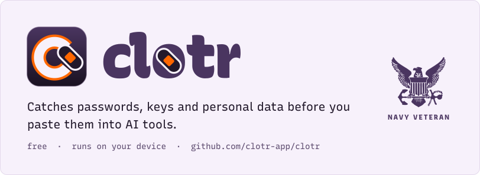

### BilliamBaSH

Navy veteran, comp sci student. Jack of all trades, master of none. Yet.

<a href="https://github.com/clotr-app/clotr">
  <picture>
    <source media="(prefers-color-scheme: dark)" srcset="clotr-card-dark.svg">
    
  </picture>
</a>

<picture>
  <source media="(prefers-color-scheme: dark)" srcset="quote-dark.svg">
  
</picture>

<picture>
  <source media="(prefers-color-scheme: dark)" srcset="badges/shelf-dark.svg">
  
</picture>

I'm a veteran. I'm a student. My contributions are my way of trying to protect more than just my country or myself.

I build, and use AI to build, privacy tools including [Clotr](https://clotr.app). It's a free on-device tool that warns people before they paste keys or personal details
into an AI chat. Along the way I find things in other open source privacy and security tools worth contributing to. Teamwork makes the dreamwork, brah.

### Things and stuff
| When | Project | What | Status |
| --- | --- | --- | --- |
| 2026-11-15 | [OpenRedaction](https://github.com/sam247/openredaction) | [False positive fixtures for technical strings](https://github.com/sam247/openredaction/pull/171) | Open |
| 2026-11-12 | [OpenRedaction](https://github.com/sam247/openredaction) | [Package versions and file names aren't emails](https://github.com/sam247/openredaction/pull/168) | Merged |
| 2026-11-11 | [KeePassXC](https://github.com/keepassxreboot/keepassxc) | [Restore KeeShare pause during database merges](https://github.com/keepassxreboot/keepassxc/pull/14067) | Open |
| 2026-10-27 | [KeePassXC](https://github.com/keepassxreboot/keepassxc) | [Replace removed CMake flags in build scripts](https://github.com/keepassxreboot/keepassxc/pull/13893) | Merged |
| 2026-10-18 | [KeePassXC](https://github.com/keepassxreboot/keepassxc) | [Document the minimum database password quality setting](https://github.com/keepassxreboot/keepassxc/pull/13802) | Open |
| 2026-10-18 | [shadow-ai-dlp](https://github.com/Erik755/shadow-ai-dlp) | [Skip placeholder OpenAI, Anthropic and xAI keys](https://github.com/Erik755/shadow-ai-dlp/pull/2) | Open |
| 2026-10-18 | [clotr-app/BilliBaSHing](https://github.com/clotr-app/BilliBaSHing) | 684 made-up examples for testing privacy and secret detectors | Published |

