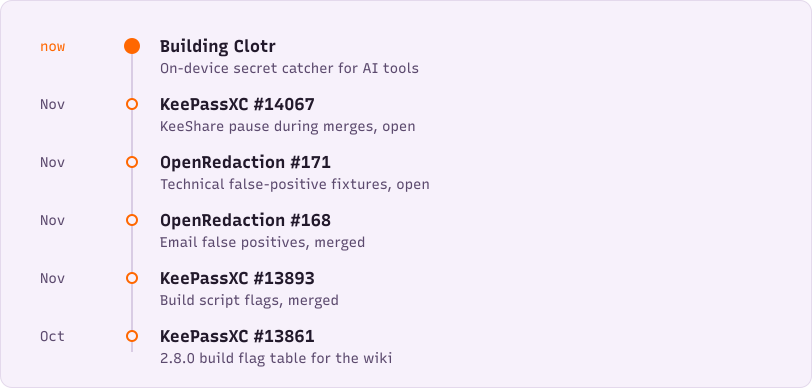

### BilliamBaSH

Navy veteran, comp sci student. Jack of all trades, master of none. Yet.

<a href="https://github.com/clotr-app/clotr">
  <picture>
    <source media="(prefers-color-scheme: dark)" srcset="clotr-card-dark.svg">
    
  </picture>
</a>

<picture>
  <source media="(prefers-color-scheme: dark)" srcset="quote-dark.svg">
  
</picture>

### What I've been working on

<picture>
  <source media="(prefers-color-scheme: dark)" srcset="work-log-dark.svg">
  
</picture>

[Clotr](https://github.com/clotr-app/clotr) · [KeePassXC #14067](https://github.com/keepassxreboot/keepassxc/pull/14067) · [OpenRedaction #171](https://github.com/sam247/openredaction/pull/171) · [OpenRedaction #168](https://github.com/sam247/openredaction/pull/168) · [KeePassXC #13893](https://github.com/keepassxreboot/keepassxc/pull/13893) · [KeePassXC #13861](https://github.com/keepassxreboot/keepassxc/issues/13861)
