### BilliamBaSH

Navy veteran, comp sci student. Jack of all trades, master of none. Yet.

<a href="https://github.com/clotr-app/clotr">
  <picture>
    <source media="(prefers-color-scheme: dark)" srcset="clotr-card-dark.svg">
    
  </picture>
</a>

<picture>
  <source media="(prefers-color-scheme: dark)" srcset="quote-dark.svg">
  
</picture>

<picture>
  <source media="(prefers-color-scheme: dark)" srcset="badges/shelf-dark.svg">
  
</picture>

I'm a veteran. I'm a student. I'm only able to do what I do because of the people. My contributions are my evolved way of trying to protect more than just my country.

I build, and use AI to build privacy tools including [Clotr](https://clotr.app), a free on-device tool that warns people before they paste keys or personal details
into an AI chat. Along the way I find things in other open source privacy and security tools worth fixing. Teamwork makes the dreamwork, brah.

Every change here was made with free student Codex credits and reviewed by me before it went out. I'd rather not do the grunt work myself, but I've got student credits. This is an extension of my university learning in software life cycle. So like, make sure neither me or the AI is an idiot before you commit whatever I send (we?).

The shelf updates once a day from my PRs. Badges only I can judge live in [badges/achievements.toml](badges/achievements.toml).

### Everything I've sent

| When | Project | What | Status |
| --- | --- | --- | --- |
| 2026-11-15 | [OpenRedaction](https://github.com/sam247/openredaction) | [False positive fixtures for technical strings](https://github.com/sam247/openredaction/pull/171) | Open |
| 2026-11-12 | [OpenRedaction](https://github.com/sam247/openredaction) | [Package versions and file names aren't emails](https://github.com/sam247/openredaction/pull/168) | Merged |
| 2026-11-11 | [KeePassXC](https://github.com/keepassxreboot/keepassxc) | [Restore KeeShare pause during database merges](https://github.com/keepassxreboot/keepassxc/pull/14067) | Open |
| 2026-10-27 | [KeePassXC](https://github.com/keepassxreboot/keepassxc) | [Replace removed CMake flags in build scripts](https://github.com/keepassxreboot/keepassxc/pull/13893) | Merged |
| 2026-10-18 | [KeePassXC](https://github.com/keepassxreboot/keepassxc) | [Document the minimum database password quality setting](https://github.com/keepassxreboot/keepassxc/pull/13802) | Open |
| 2026-10-18 | [shadow-ai-dlp](https://github.com/Erik755/shadow-ai-dlp) | [Skip placeholder OpenAI, Anthropic and xAI keys](https://github.com/Erik755/shadow-ai-dlp/pull/2) | Open |
| 2026-10-18 | [clotr-app/BilliBaSHing](https://github.com/clotr-app/BilliBaSHing) | 684 made-up examples for testing privacy and secret detectors | Published |

### Security reports

Reports go to each project privately first. They show up here only after the fix is out and the maintainer is fine
with it being public. None are public yet.
